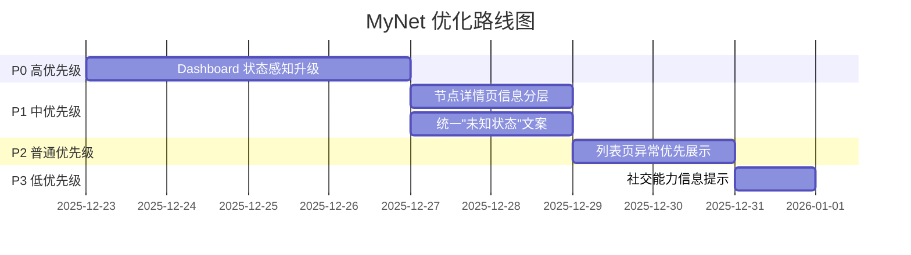

# MyNet 产品级优化方案

> 方案版本：v1.0  
> 创建日期：2025-12-22  
> 目标：从"工程信息展示系统"升级为"可感知状态的网络管理产品"

---

## 📋 优化原则（必须遵守）

### ✅ 允许的改动
- ✅ 增量优化现有组件
- ✅ 结构重排和信息分层
- ✅ 状态补充和逻辑增强
- ✅ 文案优化和用户引导

### ❌ 禁止的改动
- ❌ 推翻重做整个模块
- ❌ 重新设计系统架构
- ❌ 修改导航结构
- ❌ 引入新名词或概念
- ❌ UI 大规模重构
- ❌ "先写接口再用"的过度工程化

---

## 📊 优化路线图



---

## 🎯 阶段一：Dashboard 状态感知升级（P0）

### 目标
Dashboard 必须从"入口集合页"升级为"状态决策页"。

### 现状问题
```typescript
// src/composables/useDashboard.ts - 当前实现
const dashboardData = ref({
  totalNodes: 0,
  onlineNodes: 0,
  offlineNodes: 0,
  totalRoutes: 0,
  activeRoutes: 0,
  systemStatus: 'healthy',  // ❌ 写死的，未动态计算
  lastUpdate: new Date()
})
```

### 优化方案

#### 1.1 新增网络健康摘要（顶部）

**位置：** `src/components/dashboard/NetworkHealthSummary.vue`（新建）

**数据结构扩展：**
```typescript
// src/composables/useDashboard.ts
interface DashboardData {
  // 现有字段...
  totalNodes: number
  onlineNodes: number
  offlineNodes: number
  
  // 新增字段
  healthStatus: 'healthy' | 'warning' | 'critical'  // 动态计算
  healthMessage: string  // 一句话健康摘要
  abnormalNodes: Node[]  // 异常节点列表
  pendingTasks: PendingTask[]  // 待处理任务
  friendConnections: number  // 来自好友的连接数
}

interface PendingTask {
  type: 'offline_node' | 'pending_connection' | 'unconfigured_node'
  count: number
  message: string
  action: string  // 跳转路径
}
```

**健康状态判断逻辑：**
```typescript
// src/composables/useDashboard.ts
const calculateHealthStatus = (): 'healthy' | 'warning' | 'critical' => {
  const { totalNodes, onlineNodes, abnormalNodes, pendingTasks } = dashboardData.value
  
  // 严重情况
  if (abnormalNodes.length > 0 || onlineNodes === 0) {
    return 'critical'
  }
  
  // 警告情况
  const onlineRate = (onlineNodes / totalNodes) * 100
  if (onlineRate < 80 || pendingTasks.length > 0) {
    return 'warning'
  }
  
  // 健康情况
  return 'healthy'
}

const getHealthMessage = (): string => {
  const { healthStatus, totalNodes, onlineNodes, abnormalNodes } = dashboardData.value
  
  switch (healthStatus) {
    case 'healthy':
      return `网络运行正常（${onlineNodes} 个节点在线）`
    case 'warning':
      return `检测到 ${totalNodes - onlineNodes} 个离线节点，建议检查`
    case 'critical':
      return `检测到 ${abnormalNodes.length} 个异常节点，需要立即处理`
    default:
      return '网络状态未知'
  }
}
```

**UI 组件：**
```vue
<!-- src/components/dashboard/NetworkHealthSummary.vue -->
<template>
  <q-card class="health-summary" :class="`health-${healthStatus}`">
    <q-card-section class="row items-center">
      <q-icon 
        :name="getHealthIcon()" 
        size="3rem" 
        :color="getHealthColor()"
        class="q-mr-md"
      />
      <div class="col">
        <div class="text-h5 text-weight-bold">
          {{ healthMessage }}
        </div>
        <div v-if="pendingTasks.length > 0" class="text-body2 q-mt-sm">
          <q-chip
            v-for="task in pendingTasks"
            :key="task.type"
            :color="getTaskColor(task.type)"
            text-color="white"
            size="sm"
            clickable
            @click="handleTaskClick(task)"
            class="q-mr-xs"
          >
            <q-icon name="warning" size="xs" class="q-mr-xs" />
            {{ task.message }}
          </q-chip>
        </div>
      </div>
      <q-btn
        v-if="healthStatus !== 'healthy'"
        color="primary"
        label="查看详情"
        @click="handleViewDetails"
      />
    </q-card-section>
  </q-card>
</template>

<script setup lang="ts">
interface Props {
  healthStatus: 'healthy' | 'warning' | 'critical'
  healthMessage: string
  pendingTasks: PendingTask[]
}

const getHealthIcon = () => {
  switch (props.healthStatus) {
    case 'healthy': return 'check_circle'
    case 'warning': return 'warning'
    case 'critical': return 'error'
  }
}

const getHealthColor = () => {
  switch (props.healthStatus) {
    case 'healthy': return 'positive'
    case 'warning': return 'warning'
    case 'critical': return 'negative'
  }
}

const handleTaskClick = (task: PendingTask) => {
  router.push(task.action)
}
</script>

<style lang="scss" scoped>
.health-summary {
  &.health-healthy {
    border-left: 4px solid var(--q-positive);
  }
  &.health-warning {
    border-left: 4px solid var(--q-warning);
  }
  &.health-critical {
    border-left: 4px solid var(--q-negative);
  }
}
</style>
```

#### 1.2 新增异常优先区（中部）

**位置：** `src/components/dashboard/AbnormalItemsSection.vue`（新建）

```vue
<template>
  <div v-if="hasAbnormalItems" class="abnormal-section q-mb-lg">
    <div class="text-h6 q-mb-md">
      <q-icon name="warning" color="warning" class="q-mr-sm" />
      需要关注的问题
    </div>
    
    <!-- 离线节点 -->
    <q-card v-if="offlineNodes.length > 0" class="q-mb-md">
      <q-card-section>
        <div class="row items-center justify-between">
          <div class="text-subtitle1">
            <q-icon name="wifi_off" color="negative" class="q-mr-sm" />
            离线节点（{{ offlineNodes.length }}）
          </div>
          <q-btn 
            flat 
            dense 
            label="查看全部" 
            @click="$router.push('/app/nodes?filter=offline')"
          />
        </div>
        <q-list dense>
          <q-item 
            v-for="node in offlineNodes.slice(0, 5)" 
            :key="node.id"
            clickable
            @click="$router.push(`/app/nodes/${node.id}`)"
          >
            <q-item-section avatar>
              <q-icon name="router" color="grey" />
            </q-item-section>
            <q-item-section>
              <q-item-label>{{ node.node_name }}</q-item-label>
              <q-item-label caption>
                最后在线：{{ formatRelativeTime(node.last_seen) }}
              </q-item-label>
            </q-item-section>
          </q-item>
        </q-list>
      </q-card-section>
    </q-card>
    
    <!-- 待处理连接 -->
    <q-card v-if="pendingConnections.length > 0" class="q-mb-md">
      <q-card-section>
        <div class="row items-center justify-between">
          <div class="text-subtitle1">
            <q-icon name="schedule" color="orange" class="q-mr-sm" />
            待处理连接（{{ pendingConnections.length }}）
          </div>
          <q-btn 
            flat 
            dense 
            label="立即处理" 
            @click="$router.push('/app/routes/pending')"
          />
        </div>
      </q-card-section>
    </q-card>
    
    <!-- 未配置节点 -->
    <q-card v-if="unconfiguredNodes.length > 0">
      <q-card-section>
        <div class="row items-center justify-between">
          <div class="text-subtitle1">
            <q-icon name="settings" color="warning" class="q-mr-sm" />
            未完成配置（{{ unconfiguredNodes.length }}）
          </div>
          <q-btn 
            flat 
            dense 
            label="完成配置" 
            @click="$router.push('/app/nodes?filter=unconfigured')"
          />
        </div>
      </q-card-section>
    </q-card>
  </div>
  
  <!-- 一切正常时的提示 -->
  <q-banner v-else class="bg-positive-1 text-positive-8 q-mb-lg">
    <template #avatar>
      <q-icon name="check_circle" color="positive" />
    </template>
    <div class="text-body1">
      所有系统运行正常，无需处理任何问题
    </div>
  </q-banner>
</template>

<script setup lang="ts">
interface Props {
  offlineNodes: Node[]
  pendingConnections: any[]
  unconfiguredNodes: Node[]
}

const hasAbnormalItems = computed(() => {
  return props.offlineNodes.length > 0 || 
         props.pendingConnections.length > 0 || 
         props.unconfiguredNodes.length > 0
})
</script>
```

#### 1.3 简化快速操作（底部）

**修改：** `src/pages/dashboard/DashboardPage.vue`

```vue
<template>
  <PageLayout
    :title="$t('dashboard.title')"
    :subtitle="$t('dashboard.subtitle')"
    icon="dashboard"
  >
    <!-- 1. 网络健康摘要 -->
    <NetworkHealthSummary
      :health-status="healthStatus"
      :health-message="healthMessage"
      :pending-tasks="pendingTasks"
      class="q-mb-lg"
    />
    
    <!-- 2. 异常优先区 -->
    <AbnormalItemsSection
      :offline-nodes="abnormalNodes.offline"
      :pending-connections="abnormalNodes.pendingConnections"
      :unconfigured-nodes="abnormalNodes.unconfigured"
      class="q-mb-lg"
    />
    
    <!-- 3. 统计卡片（简化） -->
    <DashboardStats 
      :dashboard-data="dashboardData"
      :online-rate="onlineRate"
      class="q-mb-lg"
    />
    
    <!-- 4. 快速操作（最多3个）-->
    <q-card class="q-mb-lg">
      <q-card-section>
        <div class="text-h6 q-mb-md">快速操作</div>
        <div class="row q-gutter-md">
          <q-btn
            color="primary"
            icon="add"
            label="创建节点"
            @click="$router.push('/app/nodes/create')"
            class="col"
          />
          <q-btn
            color="secondary"
            icon="add_road"
            label="创建路由"
            @click="$router.push('/app/routes/create')"
            class="col"
          />
          <q-btn
            v-if="pendingConnections.length > 0"
            color="warning"
            icon="schedule"
            :label="`处理连接 (${pendingConnections.length})`"
            @click="$router.push('/app/routes/pending')"
            class="col"
          />
        </div>
      </q-card-section>
    </q-card>
    
    <!-- 5. 最近活动（可选展开）-->
    <q-expansion-item
      label="最近活动"
      icon="history"
      default-opened
    >
      <RecentActivities :recent-activities="recentActivities" />
    </q-expansion-item>
  </PageLayout>
</template>
```

#### 1.4 文件清单

**需要修改的文件：**
- `src/composables/useDashboard.ts` - 增强数据计算逻辑
- `src/pages/dashboard/DashboardPage.vue` - 重新布局
- `src/components/dashboard/DashboardStats.vue` - 简化统计卡片

**需要新建的文件：**
- `src/components/dashboard/NetworkHealthSummary.vue` - 健康摘要组件
- `src/components/dashboard/AbnormalItemsSection.vue` - 异常项展示组件

**需要更新的国际化文件：**
- `src/i18n/zh-CN.ts`
- `src/i18n/en-US.ts`

---

## 🔧 阶段二：节点详情页信息分层（P1）

### 目标
节点详情页从"数据库字段展示页"变为"状态主线页"。

### 优化方案

#### 2.1 新增状态摘要区（最顶部）

**位置：** `src/components/node/NodeStatusSummary.vue`（新建）

```vue
<template>
  <q-card class="status-summary q-mb-md" :class="`status-${statusLevel}`">
    <q-card-section>
      <div class="row items-start q-gutter-md">
        <!-- 左侧：状态图标 -->
        <div class="col-auto">
          <q-icon 
            :name="getStatusIcon()" 
            size="4rem" 
            :color="getStatusColor()"
          />
        </div>
        
        <!-- 中间：状态信息 -->
        <div class="col">
          <div class="text-h6">{{ statusTitle }}</div>
          <div class="text-body2 text-grey-7 q-mt-xs">
            {{ statusDescription }}
          </div>
          
          <!-- 关键指标 -->
          <div class="row q-gutter-sm q-mt-md">
            <q-chip 
              :color="node.node_status === 2 ? 'positive' : 'grey'"
              text-color="white"
              size="sm"
            >
              <q-icon 
                :name="node.node_status === 2 ? 'wifi' : 'wifi_off'" 
                size="xs" 
                class="q-mr-xs"
              />
              {{ getNodeStatusText() }}
            </q-chip>
            
            <q-chip color="blue-grey-2" text-color="dark" size="sm">
              <q-icon name="schedule" size="xs" class="q-mr-xs" />
              {{ getLastSeenText() }}
            </q-chip>
          </div>
        </div>
        
        <!-- 右侧：影响和操作 -->
        <div class="col-auto text-right">
          <div class="text-caption text-grey-6">影响整体网络</div>
          <div class="text-h6" :class="affectsNetwork ? 'text-negative' : 'text-positive'">
            {{ affectsNetwork ? '是' : '否' }}
          </div>
          
          <div class="text-caption text-grey-6 q-mt-md">需要用户操作</div>
          <div class="text-h6" :class="requiresAction ? 'text-warning' : 'text-positive'">
            {{ requiresAction ? '是' : '否' }}
          </div>
          
          <q-btn
            v-if="requiresAction"
            color="primary"
            :label="actionText"
            @click="handleAction"
            class="q-mt-sm"
            size="sm"
          />
        </div>
      </div>
      
      <!-- 操作建议 -->
      <div v-if="actionSuggestions.length > 0" class="q-mt-md q-pa-sm rounded-borders bg-blue-1">
        <div class="text-caption text-blue-8 q-mb-xs">
          <q-icon name="lightbulb" class="q-mr-xs" />
          建议操作：
        </div>
        <ul class="q-ma-none q-pl-md">
          <li v-for="(suggestion, index) in actionSuggestions" :key="index" class="text-body2">
            {{ suggestion }}
          </li>
        </ul>
      </div>
    </q-card-section>
  </q-card>
</template>

<script setup lang="ts">
interface Props {
  node: Node
}

const props = defineProps<Props>()

// 计算状态级别
const statusLevel = computed(() => {
  if (props.node.node_status === -1) return 'unconfigured'  // 未配置
  if (props.node.node_status === 0) return 'disabled'       // 禁用
  if (props.node.node_status === 1) return 'offline'        // 离线
  if (props.node.node_status === 2) return 'online'         // 在线
  return 'unknown'
})

// 状态标题
const statusTitle = computed(() => {
  switch (statusLevel.value) {
    case 'online': return '节点运行正常'
    case 'offline': return '节点当前离线'
    case 'unconfigured': return '节点未完成配置'
    case 'disabled': return '节点已禁用'
    default: return '节点状态未知'
  }
})

// 状态描述
const statusDescription = computed(() => {
  switch (statusLevel.value) {
    case 'online': 
      return '节点正常运行中，可以参与网络通信和路由转发'
    case 'offline': 
      return '节点已启用但当前离线，可能影响相关路由连接'
    case 'unconfigured': 
      return '节点已创建但尚未完成必要的网络配置，暂时无法使用'
    case 'disabled': 
      return '节点已被手动禁用，不会参与任何网络活动'
    default: 
      return '无法确定节点当前状态，建议检查节点连接'
  }
})

// 是否影响整体网络
const affectsNetwork = computed(() => {
  // 如果节点有活跃路由，则影响网络
  return statusLevel.value === 'offline' && props.node.activeRoutesCount > 0
})

// 是否需要用户操作
const requiresAction = computed(() => {
  return statusLevel.value === 'unconfigured' || 
         (statusLevel.value === 'offline' && affectsNetwork.value)
})

// 操作文案
const actionText = computed(() => {
  if (statusLevel.value === 'unconfigured') return '完成配置'
  if (statusLevel.value === 'offline') return '检查连接'
  return '查看详情'
})

// 操作建议
const actionSuggestions = computed(() => {
  const suggestions: string[] = []
  
  if (statusLevel.value === 'unconfigured') {
    suggestions.push('前往节点配置页面完成 VPN 配置')
    suggestions.push('生成或上传节点密钥')
  } else if (statusLevel.value === 'offline') {
    suggestions.push('检查节点设备是否开机并连接网络')
    suggestions.push('确认节点应用程序是否正常运行')
    if (affectsNetwork.value) {
      suggestions.push('考虑临时禁用相关路由，避免连接超时')
    }
  }
  
  return suggestions
})

// 最后在线文本
const getLastSeenText = () => {
  if (!props.node.last_seen) {
    return '尚未接收到首次心跳'
  }
  return `最后在线：${formatRelativeTime(props.node.last_seen)}`
}
</script>
```

#### 2.2 信息分层布局

**修改：** `src/pages/node/NodeDetailPage.vue`

```vue
<template>
  <PageLayout>
    <!-- 第一层：状态摘要（默认展示）-->
    <NodeStatusSummary :node="node" class="q-mb-md" />
    
    <!-- 第二层：网络关键信息（默认展示）-->
    <q-card class="q-mb-md">
      <q-card-section>
        <div class="text-h6 q-mb-md">
          <q-icon name="network_check" class="q-mr-sm" />
          网络信息
        </div>
        
        <div class="row q-col-gutter-md">
          <div class="col-6 col-md-3">
            <div class="text-caption text-grey-6">内网 IP</div>
            <div class="text-body1">{{ node.node_ip || '未分配' }}</div>
          </div>
          <div class="col-6 col-md-3">
            <div class="text-caption text-grey-6">公网 IP</div>
            <div class="text-body1">{{ node.public_ip || '未知' }}</div>
          </div>
          <div class="col-6 col-md-3">
            <div class="text-caption text-grey-6">活跃路由</div>
            <div class="text-body1">{{ node.activeRoutesCount || 0 }}</div>
          </div>
          <div class="col-6 col-md-3">
            <div class="text-caption text-grey-6">连接数</div>
            <div class="text-body1">{{ node.connectionsCount || 0 }}</div>
          </div>
        </div>
      </q-card-section>
    </q-card>
    
    <!-- 第三层：详细信息（可展开）-->
    <q-expansion-item
      label="系统信息"
      icon="computer"
      header-class="text-h6"
      default-opened
    >
      <q-card>
        <q-card-section>
          <!-- 原有的系统信息内容 -->
        </q-card-section>
      </q-card>
    </q-expansion-item>
    
    <q-expansion-item
      label="应用信息"
      icon="apps"
      header-class="text-h6"
      class="q-mt-md"
    >
      <q-card>
        <q-card-section>
          <!-- 原有的应用信息内容 -->
        </q-card-section>
      </q-card>
    </q-expansion-item>
    
    <q-expansion-item
      label="网络配置"
      icon="settings_ethernet"
      header-class="text-h6"
      class="q-mt-md"
    >
      <q-card>
        <q-card-section>
          <!-- 原有的网络配置内容 -->
        </q-card-section>
      </q-card>
    </q-expansion-item>
    
    <!-- 第四层：高级信息（折叠）-->
    <q-expansion-item
      label="高级信息（调试用）"
      icon="bug_report"
      header-class="text-h6 text-grey-6"
      class="q-mt-md"
    >
      <q-banner class="bg-blue-grey-1">
        <template #avatar>
          <q-icon name="info" color="blue-grey" />
        </template>
        以下信息用于系统调试和故障排查
      </q-banner>
      
      <q-card>
        <q-card-section>
          <!-- CPU / 内核 / 防火墙 / IP转发等调试信息 -->
        </q-card-section>
      </q-card>
    </q-expansion-item>
  </PageLayout>
</template>
```

---

## 📝 阶段三：统一"未知/未设置/开发中"文案（P1）

### 目标
所有"不确定状态"必须给出可理解的解释。

### 优化方案

#### 3.1 文案映射表

**新增：** `src/utils/statusMessages.ts`

```typescript
/**
 * 状态文案映射工具
 * 用于替代简单的"未知"/"未设置"/"开发中"
 */

interface StatusMessage {
  text: string          // 显示文案
  isNormal: boolean     // 是否正常状态
  requiresAction: boolean  // 是否需要用户干预
  nextStep?: string     // 下一步说明
}

export const STATUS_MESSAGES = {
  // 节点相关
  NODE_LAST_SEEN_UNKNOWN: {
    text: '尚未接收到节点首次心跳',
    isNormal: true,
    requiresAction: false,
    nextStep: '节点启动后会自动上报状态'
  },
  
  NODE_IP_NOT_ALLOCATED: {
    text: '当前节点未分配内网 IP',
    isNormal: false,
    requiresAction: true,
    nextStep: '请前往节点配置页面分配 IP 地址'
  },
  
  NODE_PUBLIC_IP_UNKNOWN: {
    text: '节点未上报公网 IP（可能在内网环境）',
    isNormal: true,
    requiresAction: false,
    nextStep: '如节点在NAT后，这是正常现象'
  },
  
  NODE_VERSION_UNKNOWN: {
    text: '节点应用版本未知（可能未连接）',
    isNormal: false,
    requiresAction: true,
    nextStep: '请检查节点是否正常运行'
  },
  
  // 网络配置相关
  LISTEN_PORT_NOT_SET: {
    text: '当前节点未暴露服务端口',
    isNormal: true,
    requiresAction: false,
    nextStep: '如需对外提供服务，请在节点配置中设置监听端口'
  },
  
  ENDPOINT_NOT_SET: {
    text: '节点端点未配置',
    isNormal: true,
    requiresAction: false,
    nextStep: '系统将自动检测并使用节点公网地址'
  },
  
  // 设备信息相关
  DEVICE_INFO_NOT_AVAILABLE: {
    text: '设备信息暂未获取',
    isNormal: true,
    requiresAction: false,
    nextStep: '节点在线后会自动上报设备信息'
  },
  
  CPU_INFO_UNKNOWN: {
    text: 'CPU 信息未获取',
    isNormal: true,
    requiresAction: false,
    nextStep: '节点在线后会自动检测'
  },
  
  // 功能开发状态
  FEATURE_COMING_SOON: {
    text: '该功能正在开发中',
    isNormal: true,
    requiresAction: false,
    nextStep: '敬请期待后续版本更新'
  }
} as const

export type StatusMessageKey = keyof typeof STATUS_MESSAGES

/**
 * 获取状态消息
 */
export function getStatusMessage(key: StatusMessageKey): StatusMessage {
  return STATUS_MESSAGES[key]
}

/**
 * 格式化状态显示
 */
export function formatStatusDisplay(
  key: StatusMessageKey, 
  options: { showNextStep?: boolean } = {}
): string {
  const msg = getStatusMessage(key)
  
  if (options.showNextStep && msg.nextStep) {
    return `${msg.text}（${msg.nextStep}）`
  }
  
  return msg.text
}
```

#### 3.2 应用到组件

**修改示例：** `src/pages/node/NodeDetailPage.vue`

```vue
<template>
  <!-- 替换前 -->
  <div>最后在线：{{ node.last_seen ? formatDate(node.last_seen) : $t('common.unknown') }}</div>
  
  <!-- 替换后 -->
  <div>
    最后在线：
    <span v-if="node.last_seen">{{ formatDate(node.last_seen) }}</span>
    <span v-else class="text-grey-6">
      {{ formatStatusDisplay('NODE_LAST_SEEN_UNKNOWN') }}
      <q-tooltip>{{ getStatusMessage('NODE_LAST_SEEN_UNKNOWN').nextStep }}</q-tooltip>
    </span>
  </div>
  
  <!-- 替换前 -->
  <div>节点版本：{{ node?.node_app_version || $t('common.unknown') }}</div>
  
  <!-- 替换后 -->
  <div>
    节点版本：
    <span v-if="node?.node_app_version">{{ node.node_app_version }}</span>
    <span v-else class="text-warning">
      {{ formatStatusDisplay('NODE_VERSION_UNKNOWN', { showNextStep: true }) }}
    </span>
  </div>
</template>

<script setup lang="ts">
import { getStatusMessage, formatStatusDisplay } from '@/utils/statusMessages'
</script>
```

#### 3.3 国际化支持

**更新：** `src/i18n/zh-CN.ts`

```typescript
export default {
  statusMessages: {
    nodeLastSeenUnknown: '尚未接收到节点首次心跳（节点可能未启动）',
    nodeIpNotAllocated: '当前节点未分配内网 IP（请前往配置页面分配）',
    nodePublicIpUnknown: '节点未上报公网 IP（可能在内网环境，这是正常现象）',
    // ... 其他状态文案
  }
}
```

---

## 📋 阶段四：列表页异常优先展示（P2）

### 目标
列表页默认突出"异常/有变化"的条目。

### 优化方案

#### 4.1 增强排序逻辑

**修改：** `src/pages/node/NodeListPage.vue`

```typescript
// 当前：简单筛选
const filteredNodes = computed(() => {
  return nodes.value.filter(node => {
    // 筛选逻辑
  })
})

// 优化后：异常优先排序
const filteredNodes = computed(() => {
  return nodes.value
    .filter(node => {
      // 筛选逻辑保持不变
    })
    .sort((a, b) => {
      // 1. 异常节点优先
      const aAbnormal = isAbnormalNode(a)
      const bAbnormal = isAbnormalNode(b)
      if (aAbnormal && !bAbnormal) return -1
      if (!aAbnormal && bAbnormal) return 1
      
      // 2. 最近变化优先
      const aLastSeen = new Date(a.last_seen || 0).getTime()
      const bLastSeen = new Date(b.last_seen || 0).getTime()
      return bLastSeen - aLastSeen
    })
})

// 判断是否为异常节点
const isAbnormalNode = (node: Node): boolean => {
  // 离线节点
  if (node.node_status === 1) return true
  
  // 未配置节点
  if (node.node_status === -1) return true
  
  // 长时间未心跳（超过1小时）
  if (node.last_seen) {
    const hoursSinceLastSeen = (Date.now() - new Date(node.last_seen).getTime()) / (1000 * 60 * 60)
    if (hoursSinceLastSeen > 1) return true
  }
  
  return false
}
```

#### 4.2 视觉高亮

```vue
<ResponsiveCardGrid :items="filteredNodes">
  <template #default="{ item: node }">
    <q-card :class="{ 'abnormal-node': isAbnormalNode(node) }">
      <!-- 卡片内容 -->
    </q-card>
  </template>
</ResponsiveCardGrid>

<style lang="scss" scoped>
.abnormal-node {
  border-left: 4px solid var(--q-warning);
  box-shadow: 0 2px 8px rgba(255, 152, 0, 0.2);
  
  &:hover {
    transform: translateY(-2px);
    box-shadow: 0 4px 12px rgba(255, 152, 0, 0.3);
  }
}
</style>
```

---

## 🤝 阶段五：社交能力信息提示（P3）

### 目标
在关键位置显示"是否涉及好友关系"。

### 优化方案

#### 5.1 节点详情页添加好友访问提示

**修改：** `src/pages/node/NodeDetailPage.vue`

```vue
<q-card class="q-mb-md">
  <q-card-section>
    <div class="text-h6 q-mb-md">
      <q-icon name="network_check" class="q-mr-sm" />
      网络信息
    </div>
    
    <!-- 新增好友访问提示 -->
    <q-banner 
      v-if="friendAccessInfo.hasFriendAccess"
      class="bg-blue-1 text-blue-8 q-mb-md"
    >
      <template #avatar>
        <q-icon name="people" color="blue" />
      </template>
      <div class="text-body2">
        该节点被 <strong>{{ friendAccessInfo.friendCount }}</strong> 位好友访问
        <q-btn 
          flat 
          dense 
          size="sm" 
          label="查看详情" 
          @click="showFriendAccessDialog = true"
          class="q-ml-sm"
        />
      </div>
    </q-banner>
    
    <!-- ... 原有内容 -->
  </q-card-section>
</q-card>

<script setup lang="ts">
interface FriendAccessInfo {
  hasFriendAccess: boolean
  friendCount: number
  friendNames: string[]
}

const friendAccessInfo = ref<FriendAccessInfo>({
  hasFriendAccess: false,
  friendCount: 0,
  friendNames: []
})

// 加载好友访问信息
const loadFriendAccessInfo = async () => {
  try {
    const response = await api.get(`/nodes/${nodeId}/friend-access`)
    friendAccessInfo.value = response.data
  } catch (error) {
    // 忽略错误，不影响主流程
  }
}
</script>
```

#### 5.2 路由详情页添加好友网络提示

**修改：** `src/pages/route/ConnectionDetailsPage.vue`

```vue
<q-banner 
  v-if="isCrossFriendNetwork"
  class="bg-green-1 text-green-8 q-mb-md"
>
  <template #avatar>
    <q-icon name="people" color="green" />
  </template>
  <div class="text-body2">
    该路由连接跨越好友网络（{{ sourceFriendName }} ⇄ {{ targetFriendName }}）
  </div>
</q-banner>
```

#### 5.3 Dashboard 添加好友连接统计

**修改：** `src/components/dashboard/DashboardStats.vue`

```vue
<!-- 在统计卡片中新增一个 -->
<q-card-section class="text-center">
  <q-icon name="people" size="2rem" color="blue" />
  <div class="text-h4 q-mt-sm">{{ friendConnections }}</div>
  <div class="text-caption text-grey-6">来自好友的连接</div>
</q-card-section>
```

---

## ✅ 验收标准（自检清单）

### Dashboard 验收
- [ ] 用户登录后 5 秒内知道系统是否正常
- [ ] 页面顶部有一句话健康摘要
- [ ] 异常节点/连接清晰展示
- [ ] 有明确的"下一步操作"引导
- [ ] 没有"系统状态：健康"这种写死的文案

### 节点详情页验收
- [ ] 顶部 3 秒可读懂节点状态
- [ ] 有状态摘要区（状态+影响+操作）
- [ ] 信息分为 3 层（关键信息、详细信息、调试信息）
- [ ] "高级信息"明确标注
- [ ] 没有"未知"状态未解释的情况

### 文案验收
- [ ] 所有"未知"都有解释
- [ ] 所有状态说明"是否正常"
- [ ] 所有状态说明"是否需要操作"
- [ ] 所有状态说明"下一步会怎样"

### 列表页验收
- [ ] 异常项排在最前面
- [ ] 异常项有视觉高亮
- [ ] 正常项不隐藏，但弱化

### 社交能力验收
- [ ] 节点详情页显示好友访问信息
- [ ] 路由详情页显示是否跨好友网络
- [ ] Dashboard 显示好友连接统计

---

## 📦 交付物清单

### 代码文件
```
src/
├── components/
│   ├── dashboard/
│   │   ├── NetworkHealthSummary.vue       [新建]
│   │   ├── AbnormalItemsSection.vue       [新建]
│   │   ├── DashboardStats.vue             [修改]
│   │   └── RecentActivities.vue           [保持]
│   └── node/
│       └── NodeStatusSummary.vue          [新建]
├── composables/
│   └── useDashboard.ts                    [修改]
├── pages/
│   ├── dashboard/
│   │   └── DashboardPage.vue              [修改]
│   └── node/
│       ├── NodeListPage.vue               [修改]
│       └── NodeDetailPage.vue             [修改]
├── utils/
│   └── statusMessages.ts                  [新建]
└── i18n/
    ├── zh-CN.ts                           [修改]
    └── en-US.ts                           [修改]
```

### 文档
- [x] MYNET_SYSTEM_ASSESSMENT_REPORT.md - 系统评估报告
- [x] MYNET_OPTIMIZATION_PLAN.md - 优化方案（本文档）
- [ ] DASHBOARD_RENOVATION_PLAN.md - Dashboard 改造详细方案

---

## 🚀 实施建议

### 建议实施顺序
1. **第1天：** Dashboard 数据层改造（useDashboard.ts）
2. **第2天：** Dashboard UI 组件开发
3. **第3天：** 节点详情页状态摘要区
4. **第4天：** 文案映射工具 + 批量替换
5. **第5天：** 列表页排序优化 + 社交提示

### 并行开发建议
- 文案优化可以与其他任务并行
- 社交提示可以最后添加（不影响核心流程）

---

**方案制定日期：** 2025-12-22  
**下一步：** 查看 [DASHBOARD_RENOVATION_PLAN.md](./DASHBOARD_RENOVATION_PLAN.md) 了解 Dashboard 详细改造方案
