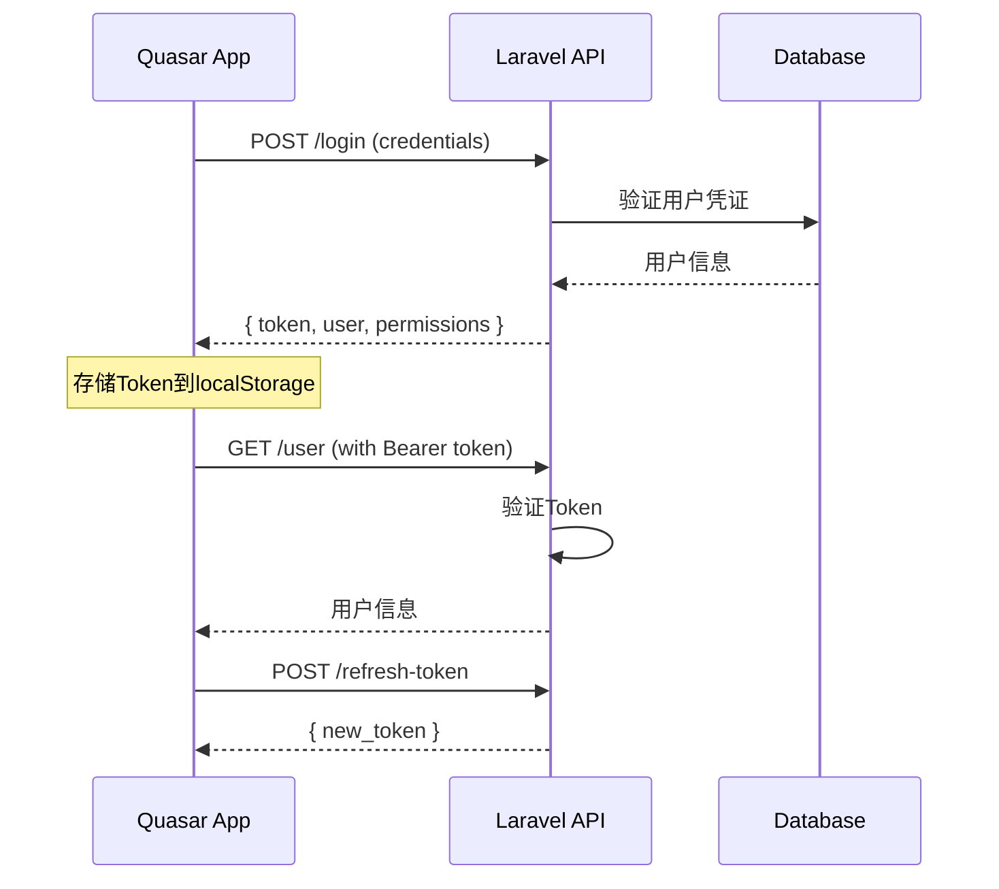

# MyNet Quasar API 文档

## 📋 API 概述

MyNet Quasar 与 Laravel 后端通过 RESTful API 进行通信，支持完整的 CRUD 操作、实时数据同步和多Zone隔离。

### 基础信息

```
API Base URL: http://localhost:8000/api/v1
WebSocket URL: ws://localhost:8000/ws
认证方式: Bearer Token (Laravel Sanctum)
数据格式: JSON
```

## 🔐 认证机制

### Token 认证

```typescript
// 请求头格式
{
  "Authorization": "Bearer {token}",
  "Content-Type": "application/json",
  "Accept": "application/json",
  "X-Zone-ID": "{zone_id}"  // Zone隔离
}
```

### 认证流程



## 🔗 API 端点列表

### 认证相关 API (12个)

#### 1. 用户登录
```
POST /api/v1/login
```

**请求体:**
```json
{
  "email": "user@example.com",
  "password": "password123",
  "remember": true
}
```

**响应:**
```json
{
  "success": true,
  "data": {
    "token": "eyJ0eXAiOiJKV1QiLCJhbGciOiJSUzI1NiJ9...",
    "user": {
      "id": "usr_123",
      "name": "John Doe",
      "email": "user@example.com",
      "role": "user",
      "zone_id": "zone_456",
      "permissions": ["read", "write"],
      "created_at": "2023-01-01T00:00:00.000Z",
      "updated_at": "2023-01-01T00:00:00.000Z"
    }
  },
  "message": "Login successful"
}
```

#### 2. 用户注册
```
POST /api/v1/register
```

**请求体:**
```json
{
  "name": "John Doe",
  "email": "user@example.com",
  "password": "password123",
  "password_confirmation": "password123"
}
```

#### 3. 用户登出
```
POST /api/v1/logout
```

#### 4. 获取当前用户信息
```
GET /api/v1/user
```

#### 5. 刷新Token
```
POST /api/v1/refresh-token
```

#### 6. 更新用户资料
```
PUT /api/v1/profile
```

#### 7. 修改密码
```
POST /api/v1/change-password
```

#### 8. 重置密码
```
POST /api/v1/reset-password
```

#### 9. 发送验证邮件
```
POST /api/v1/email/verification-notification
```

#### 10. 验证邮件地址
```
GET /api/v1/email/verify/{id}/{hash}
```

#### 11. 获取用户权限
```
GET /api/v1/permissions
```

#### 12. 更新用户设置
```
PUT /api/v1/settings
```

### 节点管理 API (28个)

#### 1. 获取节点列表
```
GET /api/v1/nodes
```

**查询参数:**
```
?page=1&per_page=20&search=node_name&zone_id=zone_456&status=online
```

**响应:**
```json
{
  "success": true,
  "data": {
    "nodes": [
      {
        "id": "node_123",
        "name": "Node-01",
        "display_name": "Primary Node",
        "ip_address": "192.168.1.100",
        "public_ip": "203.0.113.100",
        "port": 51820,
        "status": "online",
        "zone_id": "zone_456",
        "endpoint": "203.0.113.100:51820",
        "public_key": "wG3Wi...",
        "allowed_ips": ["10.0.0.0/24"],
        "last_handshake": "2023-01-01T00:00:00.000Z",
        "transfer_rx": 1048576,
        "transfer_tx": 2097152,
        "created_at": "2023-01-01T00:00:00.000Z",
        "updated_at": "2023-01-01T00:00:00.000Z"
      }
    ],
    "pagination": {
      "current_page": 1,
      "per_page": 20,
      "total": 100,
      "total_pages": 5
    }
  },
  "message": "Nodes retrieved successfully"
}
```

#### 2. 获取单个节点
```
GET /api/v1/nodes/{id}
```

#### 3. 创建节点
```
POST /api/v1/nodes
```

**请求体:**
```json
{
  "name": "Node-02",
  "display_name": "Secondary Node",
  "ip_address": "192.168.1.101",
  "public_ip": "203.0.113.101",
  "port": 51821,
  "zone_id": "zone_456",
  "endpoint": "203.0.113.101:51821",
  "allowed_ips": ["10.0.1.0/24"],
  "description": "备用节点"
}
```

#### 4. 更新节点
```
PUT /api/v1/nodes/{id}
```

#### 5. 删除节点
```
DELETE /api/v1/nodes/{id}
```

#### 6. 获取节点状态
```
GET /api/v1/nodes/{id}/status
```

#### 7. 启动节点
```
POST /api/v1/nodes/{id}/start
```

#### 8. 停止节点
```
POST /api/v1/nodes/{id}/stop
```

#### 9. 重启节点
```
POST /api/v1/nodes/{id}/restart
```

#### 10. 获取节点配置
```
GET /api/v1/nodes/{id}/config
```

#### 11. 更新节点配置
```
PUT /api/v1/nodes/{id}/config
```

#### 12. 获取节点日志
```
GET /api/v1/nodes/{id}/logs
```

#### 13. 获取节点统计
```
GET /api/v1/nodes/{id}/stats
```

#### 14. 获取节点连接信息
```
GET /api/v1/nodes/{id}/connections
```

#### 15. 测试节点连接
```
POST /api/v1/nodes/{id}/test-connection
```

#### 16. 生成节点配置文件
```
POST /api/v1/nodes/{id}/generate-config
```

#### 17. 下载节点配置
```
GET /api/v1/nodes/{id}/download-config
```

#### 18. 获取节点密钥
```
GET /api/v1/nodes/{id}/keys
```

#### 19. 更新节点密钥
```
PUT /api/v1/nodes/{id}/keys
```

#### 20. 删除节点密钥
```
DELETE /api/v1/nodes/{id}/keys
```

#### 21. 获取节点网络信息
```
GET /api/v1/nodes/{id}/network
```

#### 22. 更新节点网络配置
```
PUT /api/v1/nodes/{id}/network
```

#### 23. 获取节点备份
```
GET /api/v1/nodes/{id}/backup
```

#### 24. 创建节点备份
```
POST /api/v1/nodes/{id}/backup
```

#### 25. 恢复节点备份
```
POST /api/v1/nodes/{id}/restore
```

#### 26. 获取节点监控数据
```
GET /api/v1/nodes/{id}/monitoring
```

#### 27. 批量操作节点
```
POST /api/v1/nodes/batch
```

#### 28. 导出节点数据
```
GET /api/v1/nodes/export
```

### 路由管理 API (15个)

#### 1. 获取路由列表
```
GET /api/v1/routes
```

**响应:**
```json
{
  "success": true,
  "data": {
    "routes": [
      {
        "id": "route_123",
        "name": "Route-01",
        "source_node_id": "node_123",
        "destination_node_id": "node_456",
        "protocol": "UDP",
        "port": 51820,
        "status": "active",
        "zone_id": "zone_456",
        "created_at": "2023-01-01T00:00:00.000Z",
        "updated_at": "2023-01-01T00:00:00.000Z",
        "source_node": {
          "id": "node_123",
          "name": "Node-01",
          "ip_address": "192.168.1.100"
        },
        "destination_node": {
          "id": "node_456",
          "name": "Node-02",
          "ip_address": "192.168.1.101"
        }
      }
    ]
  },
  "message": "Routes retrieved successfully"
}
```

#### 2. 获取单个路由
```
GET /api/v1/routes/{id}
```

#### 3. 创建路由
```
POST /api/v1/routes
```

#### 4. 更新路由
```
PUT /api/v1/routes/{id}
```

#### 5. 删除路由
```
DELETE /api/v1/routes/{id}
```

#### 6. 获取路由状态
```
GET /api/v1/routes/{id}/status
```

#### 7. 启用路由
```
POST /api/v1/routes/{id}/enable
```

#### 8. 禁用路由
```
POST /api/v1/routes/{id}/disable
```

#### 9. 测试路由连接
```
POST /api/v1/routes/{id}/test
```

#### 10. 获取路由统计
```
GET /api/v1/routes/{id}/stats
```

#### 11. 获取路由拓扑
```
GET /api/v1/routes/topology
```

#### 12. 获取路由策略
```
GET /api/v1/routes/policies
```

#### 13. 更新路由策略
```
PUT /api/v1/routes/policies
```

#### 14. 批量操作路由
```
POST /api/v1/routes/batch
```

#### 15. 导出路由配置
```
GET /api/v1/routes/export
```

### 区域管理 API (8个)

#### 1. 获取区域列表
```
GET /api/v1/zones
```

**响应:**
```json
{
  "success": true,
  "data": {
    "zones": [
      {
        "id": "zone_123",
        "name": "Zone-01",
        "description": "主要区域",
        "permissions": ["read", "write", "admin"],
        "node_count": 10,
        "user_count": 25,
        "created_at": "2023-01-01T00:00:00.000Z",
        "updated_at": "2023-01-01T00:00:00.000Z"
      }
    ]
  },
  "message": "Zones retrieved successfully"
}
```

#### 2. 获取单个区域
```
GET /api/v1/zones/{id}
```

#### 3. 创建区域
```
POST /api/v1/zones
```

#### 4. 更新区域
```
PUT /api/v1/zones/{id}
```

#### 5. 删除区域
```
DELETE /api/v1/zones/{id}
```

#### 6. 获取区域权限
```
GET /api/v1/zones/{id}/permissions
```

#### 7. 更新区域权限
```
PUT /api/v1/zones/{id}/permissions
```

#### 8. 切换当前区域
```
POST /api/v1/zones/{id}/switch
```

### 用户管理 API (18个)

#### 1. 获取用户列表
```
GET /api/v1/users
```

#### 2. 获取单个用户
```
GET /api/v1/users/{id}
```

#### 3. 创建用户
```
POST /api/v1/users
```

#### 4. 更新用户
```
PUT /api/v1/users/{id}
```

#### 5. 删除用户
```
DELETE /api/v1/users/{id}
```

#### 6. 获取用户权限
```
GET /api/v1/users/{id}/permissions
```

#### 7. 更新用户权限
```
PUT /api/v1/users/{id}/permissions
```

#### 8. 获取用户角色
```
GET /api/v1/users/{id}/roles
```

#### 9. 更新用户角色
```
PUT /api/v1/users/{id}/roles
```

#### 10. 获取用户活动日志
```
GET /api/v1/users/{id}/activity
```

#### 11. 获取用户统计
```
GET /api/v1/users/{id}/stats
```

#### 12. 重置用户密码
```
POST /api/v1/users/{id}/reset-password
```

#### 13. 禁用用户
```
POST /api/v1/users/{id}/disable
```

#### 14. 启用用户
```
POST /api/v1/users/{id}/enable
```

#### 15. 获取用户会话
```
GET /api/v1/users/{id}/sessions
```

#### 16. 终止用户会话
```
DELETE /api/v1/users/{id}/sessions/{session_id}
```

#### 17. 批量操作用户
```
POST /api/v1/users/batch
```

#### 18. 导出用户数据
```
GET /api/v1/users/export
```

### IP池管理 API (12个)

#### 1. 获取IP池列表
```
GET /api/v1/ippools
```

**响应:**
```json
{
  "success": true,
  "data": {
    "ippools": [
      {
        "id": "pool_123",
        "name": "Pool-01",
        "network": "10.0.0.0/24",
        "start_ip": "10.0.0.1",
        "end_ip": "10.0.0.254",
        "total_ips": 254,
        "used_ips": 10,
        "available_ips": 244,
        "zone_id": "zone_456",
        "created_at": "2023-01-01T00:00:00.000Z",
        "updated_at": "2023-01-01T00:00:00.000Z"
      }
    ]
  },
  "message": "IP pools retrieved successfully"
}
```

#### 2. 获取单个IP池
```
GET /api/v1/ippools/{id}
```

#### 3. 创建IP池
```
POST /api/v1/ippools
```

#### 4. 更新IP池
```
PUT /api/v1/ippools/{id}
```

#### 5. 删除IP池
```
DELETE /api/v1/ippools/{id}
```

#### 6. 获取IP池分配情况
```
GET /api/v1/ippools/{id}/allocations
```

#### 7. 分配IP地址
```
POST /api/v1/ippools/{id}/allocate
```

#### 8. 释放IP地址
```
POST /api/v1/ippools/{id}/release
```

#### 9. 获取IP池统计
```
GET /api/v1/ippools/{id}/stats
```

#### 10. 检查IP可用性
```
GET /api/v1/ippools/{id}/check-ip
```

#### 11. 批量操作IP池
```
POST /api/v1/ippools/batch
```

#### 12. 导出IP池数据
```
GET /api/v1/ippools/export
```

### 社交功能 API (15个)

#### 1. 获取好友列表
```
GET /api/v1/friends
```

#### 2. 发送好友请求
```
POST /api/v1/friends/request
```

#### 3. 接受好友请求
```
POST /api/v1/friends/accept/{id}
```

#### 4. 拒绝好友请求
```
POST /api/v1/friends/decline/{id}
```

#### 5. 删除好友
```
DELETE /api/v1/friends/{id}
```

#### 6. 获取好友请求
```
GET /api/v1/friends/requests
```

#### 7. 搜索用户
```
GET /api/v1/users/search
```

#### 8. 获取消息列表
```
GET /api/v1/messages
```

#### 9. 发送消息
```
POST /api/v1/messages
```

#### 10. 获取对话历史
```
GET /api/v1/conversations/{id}
```

#### 11. 标记消息已读
```
POST /api/v1/messages/{id}/read
```

#### 12. 删除消息
```
DELETE /api/v1/messages/{id}
```

#### 13. 获取通知列表
```
GET /api/v1/notifications
```

#### 14. 标记通知已读
```
POST /api/v1/notifications/{id}/read
```

#### 15. 删除通知
```
DELETE /api/v1/notifications/{id}
```

## 🌐 WebSocket 实时通信

### WebSocket 连接

```typescript
// 连接WebSocket
const ws = new WebSocket('ws://localhost:8000/ws');

// 认证
ws.send(JSON.stringify({
  type: 'auth',
  token: 'your-auth-token',
  zone_id: 'zone_456'
}));
```

### 实时事件

#### 1. 节点状态更新
```json
{
  "type": "node_status_update",
  "data": {
    "node_id": "node_123",
    "status": "online",
    "timestamp": "2023-01-01T00:00:00.000Z"
  }
}
```

#### 2. 路由状态更新
```json
{
  "type": "route_status_update",
  "data": {
    "route_id": "route_123",
    "status": "active",
    "timestamp": "2023-01-01T00:00:00.000Z"
  }
}
```

#### 3. 用户在线状态
```json
{
  "type": "user_online_status",
  "data": {
    "user_id": "user_123",
    "status": "online",
    "timestamp": "2023-01-01T00:00:00.000Z"
  }
}
```

#### 4. 系统通知
```json
{
  "type": "system_notification",
  "data": {
    "title": "系统维护通知",
    "message": "系统将于今晚进行维护",
    "type": "warning",
    "timestamp": "2023-01-01T00:00:00.000Z"
  }
}
```

#### 5. 消息推送
```json
{
  "type": "message_received",
  "data": {
    "message_id": "msg_123",
    "from_user_id": "user_456",
    "content": "Hello!",
    "timestamp": "2023-01-01T00:00:00.000Z"
  }
}
```

## 📊 API 响应格式

### 标准响应格式

```typescript
interface ApiResponse<T> {
  success: boolean;
  data?: T;
  message: string;
  errors?: Record<string, string[]>;
  meta?: {
    pagination?: {
      current_page: number;
      per_page: number;
      total: number;
      total_pages: number;
    };
    timestamp: string;
    request_id: string;
  };
}
```

### 成功响应示例

```json
{
  "success": true,
  "data": {
    "id": "123",
    "name": "Example"
  },
  "message": "Operation successful",
  "meta": {
    "timestamp": "2023-01-01T00:00:00.000Z",
    "request_id": "req_123456"
  }
}
```

### 错误响应示例

```json
{
  "success": false,
  "message": "Validation failed",
  "errors": {
    "email": ["The email field is required."],
    "password": ["The password must be at least 8 characters."]
  },
  "meta": {
    "timestamp": "2023-01-01T00:00:00.000Z",
    "request_id": "req_123456"
  }
}
```

## 🔒 Zone 隔离机制

### Zone 请求头

```typescript
// 所有请求都需要包含Zone ID
const headers = {
  'Authorization': `Bearer ${token}`,
  'X-Zone-ID': 'zone_456',
  'Content-Type': 'application/json'
};
```

### Zone 权限验证

```typescript
// 权限检查响应
interface ZonePermission {
  zone_id: string;
  permissions: string[];
  can_read: boolean;
  can_write: boolean;
  can_admin: boolean;
}
```

### Zone 数据过滤

```typescript
// API响应会自动过滤当前Zone的数据
{
  "success": true,
  "data": {
    "nodes": [
      // 只返回当前Zone的节点
    ]
  },
  "meta": {
    "zone_id": "zone_456",
    "filtered": true
  }
}
```

## 📈 API 性能优化

### 1. 分页查询

```typescript
// 分页参数
interface PaginationParams {
  page: number;
  per_page: number;
  sort_by?: string;
  sort_order?: 'asc' | 'desc';
}

// 分页响应
interface PaginationResponse<T> {
  data: T[];
  pagination: {
    current_page: number;
    per_page: number;
    total: number;
    total_pages: number;
    has_next: boolean;
    has_prev: boolean;
  };
}
```

### 2. 数据缓存

```typescript
// 缓存控制头
const headers = {
  'Cache-Control': 'public, max-age=300', // 5分钟缓存
  'ETag': '"version123"',
  'Last-Modified': 'Wed, 01 Jan 2023 00:00:00 GMT'
};
```

### 3. 条件请求

```typescript
// 条件请求头
const headers = {
  'If-None-Match': '"version123"',
  'If-Modified-Since': 'Wed, 01 Jan 2023 00:00:00 GMT'
};
```

## 🛡️ 错误处理

### HTTP 状态码

```typescript
enum HttpStatus {
  OK = 200,
  CREATED = 201,
  NO_CONTENT = 204,
  BAD_REQUEST = 400,
  UNAUTHORIZED = 401,
  FORBIDDEN = 403,
  NOT_FOUND = 404,
  METHOD_NOT_ALLOWED = 405,
  CONFLICT = 409,
  UNPROCESSABLE_ENTITY = 422,
  TOO_MANY_REQUESTS = 429,
  INTERNAL_SERVER_ERROR = 500,
  SERVICE_UNAVAILABLE = 503
}
```

### 错误类型

```typescript
interface ApiError {
  code: string;
  message: string;
  details?: any;
  timestamp: string;
}

// 常见错误类型
const ErrorCodes = {
  VALIDATION_ERROR: 'VALIDATION_ERROR',
  AUTHENTICATION_ERROR: 'AUTHENTICATION_ERROR',
  AUTHORIZATION_ERROR: 'AUTHORIZATION_ERROR',
  RESOURCE_NOT_FOUND: 'RESOURCE_NOT_FOUND',
  DUPLICATE_RESOURCE: 'DUPLICATE_RESOURCE',
  RATE_LIMIT_EXCEEDED: 'RATE_LIMIT_EXCEEDED',
  SERVER_ERROR: 'SERVER_ERROR'
};
```

## 🧪 API 测试

### 使用示例

```typescript
// 认证
const authResponse = await fetch('/api/v1/login', {
  method: 'POST',
  headers: {
    'Content-Type': 'application/json'
  },
  body: JSON.stringify({
    email: 'user@example.com',
    password: 'password123'
  })
});

const { data } = await authResponse.json();
const token = data.token;

// 获取节点列表
const nodesResponse = await fetch('/api/v1/nodes', {
  headers: {
    'Authorization': `Bearer ${token}`,
    'X-Zone-ID': 'zone_456'
  }
});

const nodes = await nodesResponse.json();
```

### Postman 集合

```json
{
  "info": {
    "name": "MyNet API",
    "description": "MyNet Quasar API endpoints"
  },
  "auth": {
    "type": "bearer",
    "bearer": [
      {
        "key": "token",
        "value": "{{auth_token}}",
        "type": "string"
      }
    ]
  },
  "variable": [
    {
      "key": "base_url",
      "value": "http://localhost:8000/api/v1"
    },
    {
      "key": "zone_id",
      "value": "zone_456"
    }
  ]
}
```

## 📚 SDK 使用

### TypeScript SDK

```typescript
import { MyNetAPI } from '@/services/api';

// 初始化API客户端
const api = new MyNetAPI({
  baseURL: 'http://localhost:8000/api/v1',
  token: 'your-auth-token',
  zoneId: 'zone_456'
});

// 使用示例
const nodes = await api.nodes.list({
  page: 1,
  per_page: 20,
  status: 'online'
});

const node = await api.nodes.get('node_123');

const newNode = await api.nodes.create({
  name: 'Node-02',
  ip_address: '192.168.1.101',
  zone_id: 'zone_456'
});
```

### API 客户端配置

```typescript
interface ApiClientConfig {
  baseURL: string;
  timeout: number;
  retries: number;
  retryDelay: number;
  headers: Record<string, string>;
  interceptors: {
    request: Function[];
    response: Function[];
    error: Function[];
  };
}
```

## 📚 相关文档

- [项目概述](./01-项目概述.md)
- [架构设计](./02-架构设计.md)
- [开发指南](./03-开发指南.md)
- [迁移记录](./04-迁移记录.md)
- [部署指南](./06-部署指南.md) 