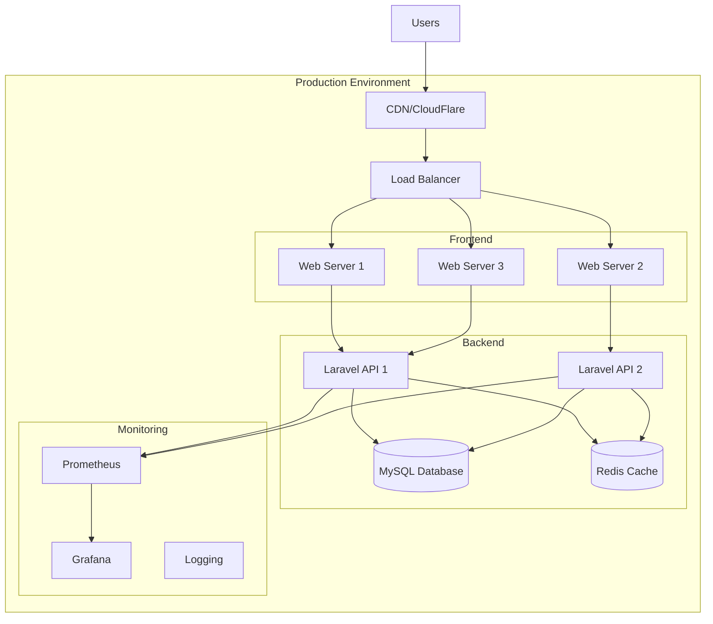

# MyNet Quasar 部署指南

## 📋 部署概述

MyNet Quasar 支持多种部署方式，包括静态文件部署、容器化部署、CDN部署等。本文档详细介绍各种部署方案的配置和实施步骤。

## 🏗️ 部署架构

### 部署架构图



## 🚀 快速部署

### 方式一：静态文件部署

```bash
# 1. 构建项目
npm run build

# 2. 复制构建文件到Web服务器
cp -r dist/spa/* /var/www/mynet/

# 3. 配置Nginx
sudo cp nginx.conf /etc/nginx/sites-available/mynet
sudo ln -s /etc/nginx/sites-available/mynet /etc/nginx/sites-enabled/
sudo systemctl reload nginx
```

### 方式二：Docker部署

```bash
# 1. 构建Docker镜像
docker build -t mynet-quasar:latest .

# 2. 运行容器
docker run -d \
  --name mynet-quasar \
  -p 80:80 \
  -e VITE_API_URL=https://api.yourdomain.com \
  mynet-quasar:latest
```

### 方式三：CDN部署

```bash
# 1. 构建并优化
npm run build:production

# 2. 上传到CDN
aws s3 sync dist/spa/ s3://your-bucket-name/ --delete

# 3. 配置CloudFront分发
aws cloudfront create-invalidation --distribution-id YOUR_DISTRIBUTION_ID --paths "/*"
```

## 🐳 Docker 部署

### Dockerfile

```dockerfile
# 多阶段构建
# 阶段1: 构建
FROM node:18-alpine AS builder

WORKDIR /app

# 复制package文件
COPY package*.json ./

# 安装依赖
RUN npm ci --only=production

# 复制源代码
COPY . .

# 构建应用
RUN npm run build

# 阶段2: 生产
FROM nginx:alpine

# 复制构建文件
COPY --from=builder /app/dist/spa /usr/share/nginx/html

# 复制Nginx配置
COPY nginx.conf /etc/nginx/nginx.conf

# 复制环境变量替换脚本
COPY docker-entrypoint.sh /docker-entrypoint.sh
RUN chmod +x /docker-entrypoint.sh

# 暴露端口
EXPOSE 80

# 启动脚本
ENTRYPOINT ["/docker-entrypoint.sh"]
CMD ["nginx", "-g", "daemon off;"]
```

### docker-entrypoint.sh

```bash
#!/bin/sh

# 替换环境变量
envsubst '${VITE_API_URL}' < /usr/share/nginx/html/index.html.template > /usr/share/nginx/html/index.html

# 启动Nginx
exec "$@"
```

### docker-compose.yml

```yaml
version: '3.8'

services:
  mynet-quasar:
    build: .
    ports:
      - "80:80"
    environment:
      - VITE_API_URL=https://api.yourdomain.com
      - VITE_WS_URL=wss://api.yourdomain.com/ws
    volumes:
      - ./nginx.conf:/etc/nginx/nginx.conf:ro
    restart: unless-stopped
    networks:
      - mynet-network

  nginx-proxy:
    image: nginx:alpine
    ports:
      - "443:443"
    volumes:
      - ./ssl:/etc/nginx/ssl:ro
      - ./proxy.conf:/etc/nginx/nginx.conf:ro
    depends_on:
      - mynet-quasar
    restart: unless-stopped
    networks:
      - mynet-network

networks:
  mynet-network:
    driver: bridge
```

## 🌐 Web服务器配置

### Nginx 配置

```nginx
# /etc/nginx/sites-available/mynet
server {
    listen 80;
    listen [::]:80;
    server_name yourdomain.com www.yourdomain.com;
    
    # 重定向到HTTPS
    return 301 https://$server_name$request_uri;
}

server {
    listen 443 ssl http2;
    listen [::]:443 ssl http2;
    server_name yourdomain.com www.yourdomain.com;
    
    # SSL配置
    ssl_certificate /path/to/ssl/cert.pem;
    ssl_certificate_key /path/to/ssl/private.key;
    ssl_protocols TLSv1.2 TLSv1.3;
    ssl_ciphers ECDHE-RSA-AES256-GCM-SHA512:DHE-RSA-AES256-GCM-SHA512:ECDHE-RSA-AES256-GCM-SHA384:DHE-RSA-AES256-GCM-SHA384;
    ssl_prefer_server_ciphers off;
    
    # 根目录
    root /var/www/mynet/dist/spa;
    index index.html;
    
    # Gzip压缩
    gzip on;
    gzip_vary on;
    gzip_min_length 1024;
    gzip_types text/plain text/css text/xml text/javascript application/javascript application/xml+rss application/json;
    
    # 缓存配置
    location ~* \.(js|css|png|jpg|jpeg|gif|ico|svg|woff|woff2|ttf|eot)$ {
        expires 1y;
        add_header Cache-Control "public, immutable";
    }
    
    # SPA路由支持
    location / {
        try_files $uri $uri/ /index.html;
    }
    
    # API代理
    location /api/ {
        proxy_pass http://backend-api;
        proxy_set_header Host $host;
        proxy_set_header X-Real-IP $remote_addr;
        proxy_set_header X-Forwarded-For $proxy_add_x_forwarded_for;
        proxy_set_header X-Forwarded-Proto $scheme;
    }
    
    # WebSocket代理
    location /ws/ {
        proxy_pass http://backend-api;
        proxy_http_version 1.1;
        proxy_set_header Upgrade $http_upgrade;
        proxy_set_header Connection "upgrade";
        proxy_set_header Host $host;
        proxy_set_header X-Real-IP $remote_addr;
        proxy_set_header X-Forwarded-For $proxy_add_x_forwarded_for;
        proxy_set_header X-Forwarded-Proto $scheme;
    }
    
    # 安全头
    add_header X-Frame-Options "SAMEORIGIN" always;
    add_header X-XSS-Protection "1; mode=block" always;
    add_header X-Content-Type-Options "nosniff" always;
    add_header Referrer-Policy "no-referrer-when-downgrade" always;
    add_header Content-Security-Policy "default-src 'self' http: https: data: blob: 'unsafe-inline'" always;
}

# 上游服务器
upstream backend-api {
    server 127.0.0.1:8000;
    # server 127.0.0.1:8001; # 负载均衡
}
```

### Apache 配置

```apache
<VirtualHost *:80>
    ServerName yourdomain.com
    ServerAlias www.yourdomain.com
    DocumentRoot /var/www/mynet/dist/spa
    
    # 重定向到HTTPS
    Redirect permanent / https://yourdomain.com/
</VirtualHost>

<VirtualHost *:443>
    ServerName yourdomain.com
    ServerAlias www.yourdomain.com
    DocumentRoot /var/www/mynet/dist/spa
    
    # SSL配置
    SSLEngine on
    SSLCertificateFile /path/to/ssl/cert.pem
    SSLCertificateKeyFile /path/to/ssl/private.key
    
    # 启用压缩
    LoadModule deflate_module modules/mod_deflate.so
    <Location />
        SetOutputFilter DEFLATE
        SetEnvIfNoCase Request_URI \
            \.(?:gif|jpe?g|png)$ no-gzip dont-vary
        SetEnvIfNoCase Request_URI \
            \.(?:exe|t?gz|zip|bz2|sit|rar)$ no-gzip dont-vary
    </Location>
    
    # SPA路由支持
    <Directory "/var/www/mynet/dist/spa">
        RewriteEngine On
        RewriteBase /
        RewriteRule ^index\.html$ - [L]
        RewriteCond %{REQUEST_FILENAME} !-f
        RewriteCond %{REQUEST_FILENAME} !-d
        RewriteRule . /index.html [L]
    </Directory>
    
    # 缓存配置
    <LocationMatch "\.(css|js|png|jpg|jpeg|gif|ico|svg|woff|woff2|ttf|eot)$">
        ExpiresActive On
        ExpiresDefault "access plus 1 year"
    </LocationMatch>
    
    # API代理
    ProxyPass /api/ http://localhost:8000/api/
    ProxyPassReverse /api/ http://localhost:8000/api/
    
    # WebSocket代理
    ProxyPass /ws/ ws://localhost:8000/ws/
    ProxyPassReverse /ws/ ws://localhost:8000/ws/
</VirtualHost>
```

## ☁️ 云平台部署

### AWS部署

#### S3 + CloudFront 部署

```bash
# 1. 创建S3存储桶
aws s3 mb s3://mynet-quasar-app

# 2. 配置存储桶策略
aws s3api put-bucket-policy --bucket mynet-quasar-app --policy file://s3-policy.json

# 3. 启用静态网站托管
aws s3 website s3://mynet-quasar-app --index-document index.html --error-document index.html

# 4. 上传构建文件
aws s3 sync dist/spa/ s3://mynet-quasar-app/ --delete

# 5. 创建CloudFront分发
aws cloudfront create-distribution --distribution-config file://cloudfront-config.json
```

#### s3-policy.json

```json
{
    "Version": "2012-10-17",
    "Statement": [
        {
            "Sid": "PublicReadGetObject",
            "Effect": "Allow",
            "Principal": "*",
            "Action": "s3:GetObject",
            "Resource": "arn:aws:s3:::mynet-quasar-app/*"
        }
    ]
}
```

#### cloudfront-config.json

```json
{
    "CallerReference": "mynet-quasar-2023",
    "Comment": "MyNet Quasar Application",
    "DefaultRootObject": "index.html",
    "Origins": {
        "Quantity": 1,
        "Items": [
            {
                "Id": "S3-mynet-quasar-app",
                "DomainName": "mynet-quasar-app.s3.amazonaws.com",
                "S3OriginConfig": {
                    "OriginAccessIdentity": ""
                }
            }
        ]
    },
    "DefaultCacheBehavior": {
        "TargetOriginId": "S3-mynet-quasar-app",
        "ViewerProtocolPolicy": "redirect-to-https",
        "MinTTL": 0,
        "DefaultTTL": 86400,
        "MaxTTL": 31536000,
        "Compress": true
    },
    "Enabled": true,
    "PriceClass": "PriceClass_100"
}
```

### Vercel 部署

```json
{
  "version": 2,
  "name": "mynet-quasar",
  "builds": [
    {
      "src": "package.json",
      "use": "@vercel/static-build",
      "config": {
        "distDir": "dist/spa"
      }
    }
  ],
  "routes": [
    {
      "src": "/(.*)",
      "dest": "/index.html"
    }
  ],
  "env": {
    "VITE_API_URL": "https://api.yourdomain.com",
    "VITE_WS_URL": "wss://api.yourdomain.com/ws"
  }
}
```

### Netlify 部署

```toml
# netlify.toml
[build]
  publish = "dist/spa"
  command = "npm run build"

[build.environment]
  VITE_API_URL = "https://api.yourdomain.com"
  VITE_WS_URL = "wss://api.yourdomain.com/ws"

[[redirects]]
  from = "/*"
  to = "/index.html"
  status = 200

[[headers]]
  for = "/*"
  [headers.values]
    X-Frame-Options = "SAMEORIGIN"
    X-XSS-Protection = "1; mode=block"
    X-Content-Type-Options = "nosniff"

[[headers]]
  for = "/*.js"
  [headers.values]
    Cache-Control = "public, max-age=31536000"

[[headers]]
  for = "/*.css"
  [headers.values]
    Cache-Control = "public, max-age=31536000"
```

## 🚀 CI/CD 部署

### GitHub Actions

```yaml
# .github/workflows/deploy.yml
name: Deploy to Production

on:
  push:
    branches: [ main ]
  pull_request:
    branches: [ main ]

jobs:
  test:
    runs-on: ubuntu-latest
    steps:
    - uses: actions/checkout@v3
    
    - name: Setup Node.js
      uses: actions/setup-node@v3
      with:
        node-version: '18'
        cache: 'npm'
    
    - name: Install dependencies
      run: npm ci
    
    - name: Run tests
      run: npm run test
    
    - name: Run linting
      run: npm run lint
    
    - name: Type check
      run: npm run type-check

  build:
    needs: test
    runs-on: ubuntu-latest
    if: github.ref == 'refs/heads/main'
    
    steps:
    - uses: actions/checkout@v3
    
    - name: Setup Node.js
      uses: actions/setup-node@v3
      with:
        node-version: '18'
        cache: 'npm'
    
    - name: Install dependencies
      run: npm ci
    
    - name: Build application
      run: npm run build
      env:
        VITE_API_URL: ${{ secrets.VITE_API_URL }}
        VITE_WS_URL: ${{ secrets.VITE_WS_URL }}
    
    - name: Upload build artifacts
      uses: actions/upload-artifact@v3
      with:
        name: dist
        path: dist/spa

  deploy:
    needs: build
    runs-on: ubuntu-latest
    if: github.ref == 'refs/heads/main'
    
    steps:
    - name: Download build artifacts
      uses: actions/download-artifact@v3
      with:
        name: dist
        path: dist
    
    - name: Deploy to S3
      uses: aws-actions/configure-aws-credentials@v2
      with:
        aws-access-key-id: ${{ secrets.AWS_ACCESS_KEY_ID }}
        aws-secret-access-key: ${{ secrets.AWS_SECRET_ACCESS_KEY }}
        aws-region: us-east-1
    
    - name: Sync files to S3
      run: |
        aws s3 sync dist/ s3://${{ secrets.S3_BUCKET }}/ --delete
    
    - name: Invalidate CloudFront
      run: |
        aws cloudfront create-invalidation --distribution-id ${{ secrets.CLOUDFRONT_DISTRIBUTION_ID }} --paths "/*"
```

### GitLab CI/CD

```yaml
# .gitlab-ci.yml
stages:
  - test
  - build
  - deploy

variables:
  NODE_VERSION: "18"

cache:
  paths:
    - node_modules/

test:
  stage: test
  image: node:$NODE_VERSION-alpine
  script:
    - npm ci
    - npm run test
    - npm run lint
    - npm run type-check
  only:
    - merge_requests
    - main

build:
  stage: build
  image: node:$NODE_VERSION-alpine
  script:
    - npm ci
    - npm run build
  artifacts:
    paths:
      - dist/spa
    expire_in: 1 hour
  only:
    - main

deploy_production:
  stage: deploy
  image: alpine:latest
  before_script:
    - apk add --no-cache aws-cli
  script:
    - aws s3 sync dist/spa/ s3://$S3_BUCKET/ --delete
    - aws cloudfront create-invalidation --distribution-id $CLOUDFRONT_DISTRIBUTION_ID --paths "/*"
  only:
    - main
  environment:
    name: production
    url: https://yourdomain.com
```

## 📊 监控和日志

### 应用监控

```typescript
// src/utils/monitoring.ts
import { createApp } from 'vue';

// 性能监控
export const setupPerformanceMonitoring = () => {
  // 页面加载时间
  window.addEventListener('load', () => {
    const loadTime = performance.timing.loadEventEnd - performance.timing.navigationStart;
    console.log('Page load time:', loadTime);
    
    // 发送到监控服务
    if (typeof gtag !== 'undefined') {
      gtag('event', 'timing_complete', {
        name: 'load',
        value: loadTime
      });
    }
  });
  
  // 错误监控
  window.addEventListener('error', (event) => {
    console.error('Global error:', event.error);
    
    // 发送错误到监控服务
    if (typeof gtag !== 'undefined') {
      gtag('event', 'exception', {
        description: event.error.message,
        fatal: false
      });
    }
  });
  
  // Vue错误处理
  const app = createApp({});
  app.config.errorHandler = (error, instance, info) => {
    console.error('Vue error:', error, info);
    
    // 发送错误到监控服务
    if (typeof gtag !== 'undefined') {
      gtag('event', 'exception', {
        description: `Vue Error: ${error.message}`,
        fatal: false
      });
    }
  };
};
```

### Nginx 日志配置

```nginx
# 自定义日志格式
log_format main_ext '$remote_addr - $remote_user [$time_local] "$request" '
                   '$status $body_bytes_sent "$http_referer" '
                   '"$http_user_agent" "$http_x_forwarded_for" '
                   '"$host" sn="$server_name" '
                   'rt=$request_time '
                   'ua="$upstream_addr" us="$upstream_status" '
                   'ut="$upstream_response_time" ul="$upstream_response_length" '
                   'cs=$upstream_cache_status';

server {
    # 访问日志
    access_log /var/log/nginx/mynet_access.log main_ext;
    
    # 错误日志
    error_log /var/log/nginx/mynet_error.log warn;
}
```

### Docker 监控

```yaml
# docker-compose.monitoring.yml
version: '3.8'

services:
  prometheus:
    image: prom/prometheus:latest
    ports:
      - "9090:9090"
    volumes:
      - ./prometheus.yml:/etc/prometheus/prometheus.yml
      - prometheus_data:/prometheus
    command:
      - '--config.file=/etc/prometheus/prometheus.yml'
      - '--storage.tsdb.path=/prometheus'
      - '--web.console.libraries=/etc/prometheus/console_libraries'
      - '--web.console.templates=/etc/prometheus/consoles'

  grafana:
    image: grafana/grafana:latest
    ports:
      - "3000:3000"
    volumes:
      - grafana_data:/var/lib/grafana
      - ./grafana/provisioning:/etc/grafana/provisioning
    environment:
      - GF_SECURITY_ADMIN_PASSWORD=admin123

  node-exporter:
    image: prom/node-exporter:latest
    ports:
      - "9100:9100"
    command:
      - '--path.rootfs=/host'
    volumes:
      - '/:/host:ro,rslave'

volumes:
  prometheus_data:
  grafana_data:
```

## 🔧 环境配置

### 生产环境变量

```bash
# .env.prod
VITE_API_URL=https://api.yourdomain.com
VITE_WS_URL=wss://api.yourdomain.com/ws
VITE_APP_NAME=MyNet
VITE_APP_VERSION=1.0.0
VITE_ENVIRONMENT=production
VITE_DEBUG=false
VITE_SENTRY_DSN=https://your-sentry-dsn@sentry.io/project-id
```

### 构建优化配置

```typescript
// vite.config.production.ts
import { defineConfig } from 'vite';
import vue from '@vitejs/plugin-vue';
import { quasar, transformAssetUrls } from '@quasar/vite-plugin';

export default defineConfig({
  plugins: [
    vue({
      template: { transformAssetUrls }
    }),
    quasar({
      sassVariables: 'src/css/quasar.variables.scss'
    })
  ],
  build: {
    target: 'es2015',
    minify: 'esbuild',
    sourcemap: false,
    rollupOptions: {
      output: {
        manualChunks: {
          'vendor': ['vue', 'vue-router', 'pinia'],
          'quasar': ['quasar'],
          'utils': ['axios', 'lodash-es']
        }
      }
    },
    chunkSizeWarningLimit: 1000
  },
  optimizeDeps: {
    include: ['vue', 'vue-router', 'pinia', 'quasar']
  }
});
```

## 🛡️ 安全配置

### SSL/TLS 配置

```nginx
# SSL最佳实践
ssl_protocols TLSv1.2 TLSv1.3;
ssl_ciphers ECDHE-RSA-AES256-GCM-SHA512:DHE-RSA-AES256-GCM-SHA512:ECDHE-RSA-AES256-GCM-SHA384:DHE-RSA-AES256-GCM-SHA384:ECDHE-RSA-AES256-SHA384;
ssl_prefer_server_ciphers off;
ssl_session_cache shared:SSL:10m;
ssl_session_timeout 10m;

# HSTS
add_header Strict-Transport-Security "max-age=31536000; includeSubDomains" always;

# 其他安全头
add_header X-Frame-Options "SAMEORIGIN" always;
add_header X-Content-Type-Options "nosniff" always;
add_header X-XSS-Protection "1; mode=block" always;
add_header Referrer-Policy "strict-origin-when-cross-origin" always;
```

### 内容安全策略

```html
<!-- index.html -->
<meta http-equiv="Content-Security-Policy" content="
  default-src 'self';
  script-src 'self' 'unsafe-inline' 'unsafe-eval' https://www.google-analytics.com;
  style-src 'self' 'unsafe-inline' https://fonts.googleapis.com;
  font-src 'self' https://fonts.gstatic.com;
  img-src 'self' data: https:;
  connect-src 'self' https://api.yourdomain.com wss://api.yourdomain.com;
  object-src 'none';
  base-uri 'self';
  form-action 'self';
">
```

## 📈 性能优化

### 构建优化

```typescript
// vite.config.ts
export default defineConfig({
  build: {
    rollupOptions: {
      output: {
        manualChunks(id) {
          if (id.includes('node_modules')) {
            if (id.includes('vue')) {
              return 'vue';
            }
            if (id.includes('quasar')) {
              return 'quasar';
            }
            return 'vendor';
          }
        }
      }
    }
  },
  optimizeDeps: {
    include: ['vue', 'vue-router', 'pinia'],
    exclude: ['@vueuse/core']
  }
});
```

### 缓存策略

```nginx
# 静态资源缓存
location ~* \.(js|css|png|jpg|jpeg|gif|ico|svg|woff|woff2|ttf|eot)$ {
    expires 1y;
    add_header Cache-Control "public, immutable";
    add_header Vary "Accept-Encoding";
}

# HTML文件不缓存
location ~* \.html$ {
    expires -1;
    add_header Cache-Control "no-store, no-cache, must-revalidate, proxy-revalidate, max-age=0";
}
```

## 🔄 备份和恢复

### 自动备份脚本

```bash
#!/bin/bash
# backup.sh

DATE=$(date +%Y%m%d_%H%M%S)
BACKUP_DIR="/backups/mynet"
APP_DIR="/var/www/mynet"

# 创建备份目录
mkdir -p $BACKUP_DIR

# 备份应用文件
tar -czf $BACKUP_DIR/mynet_app_$DATE.tar.gz -C $APP_DIR .

# 备份配置文件
tar -czf $BACKUP_DIR/mynet_config_$DATE.tar.gz /etc/nginx/sites-available/mynet

# 清理旧备份（保留7天）
find $BACKUP_DIR -name "*.tar.gz" -mtime +7 -delete

echo "Backup completed: $DATE"
```

### 恢复脚本

```bash
#!/bin/bash
# restore.sh

BACKUP_FILE=$1
APP_DIR="/var/www/mynet"

if [ -z "$BACKUP_FILE" ]; then
    echo "Usage: $0 <backup_file>"
    exit 1
fi

# 停止服务
sudo systemctl stop nginx

# 备份当前版本
mv $APP_DIR $APP_DIR.backup.$(date +%Y%m%d_%H%M%S)

# 恢复备份
mkdir -p $APP_DIR
tar -xzf $BACKUP_FILE -C $APP_DIR

# 启动服务
sudo systemctl start nginx

echo "Restore completed"
```

## 📚 相关文档

- [项目概述](./01-项目概述.md)
- [架构设计](./02-架构设计.md)
- [开发指南](./03-开发指南.md)
- [迁移记录](./04-迁移记录.md)
- [API文档](./05-API文档.md) 